# FULL STACK WEB DEVELOPMENT
## ONLINE FOOD ORDERING AND DELIVERY TRACKING SYSTEM USING DFA
### PROJECT-BASED ASSESSMENT REPORT

---

### STUDENT DETAILS

| Particulars | Details |
| :--- | :--- |
| **NAME** | RAHUL G |
| **REGISTER NUMBER** | 732924ITR089 |
| **DEPARTMENT** | INFORMATION TECHNOLOGY |
| **YEAR** | THIRD YEAR |
| **INSTITUTION** | VELALAR COLLEGE OF ENGINEERING AND TECHNOLOGY |
| **LOCATION** | THINDAL, ERODE, TAMIL NADU. |
| **ACADEMIC YEAR** | 2026–2027 |
| **ASSIGNED PROJECT TITLE** | Online Food Ordering and Delivery Tracking System Using DFA |

---

### PROBLEM STATEMENT

Develop a modern full-stack web application for an online food ordering and delivery system where every order's lifecycle is formally validated and tracked using a **Deterministic Finite Automaton (DFA)**. 

In conventional web applications, order status management is handled via arbitrary mutable strings, permitting illegal state jumps (such as jumping from "Order Created" directly to "Delivered"), skipping kitchen and dispatch steps, and allowing illegal modifications to delivered or cancelled orders. 

The system must mathematically enforce order state transitions using a formal 5-tuple DFA $M = (Q, \Sigma, \delta, q_0, F)$. Any illegal state transition must be strictly rejected by the server with an HTTP `422 Unprocessable Entity` response. The application must integrate concepts from **Computer Networks (CN)**, **Formal Languages and Automata Theory (FLAT)**, and **Full Stack Web Development (FSWD)**.

---

### PROJECT OVERVIEW

The application provides a responsive, role-based platform connecting customers and restaurant staff:
- **Frontend (Client)**: Built with **React 18** and **Vite**, featuring a dynamic food menu with search and filters, shopping cart drawer, live order tracking timeline, interactive DFA visualizer and string simulator, and a Computer Networks inspector.
- **Backend (Server)**: Built with **Node.js** and **Express.js**, exposing RESTful API endpoints and a persistent **Socket.io** WebSocket layer for real-time bidirectional push updates.
- **DFA Validation Engine**: A dedicated backend module executing the partial transition function $\delta(q, \sigma)$. Every status modification request must pass DFA validation before touching the database.
- **Database Tier**: **MongoDB** with **Mongoose** for persistent storage of users, food items, orders, and timestamped DFA state transition history, supported by an embedded in-memory database fallback for zero-configuration execution.

---

### 1. PROJECT STRUCTURE

The project is divided into client and server folders. The client contains the React interface and frontend configuration. The server contains the Express API, database models, Socket.io layer, and DFA validation logic.

#### 1.1 Overall Project Structure

```text
RAHUL-PROJECT1/
├── client/
│   ├── src/
│   │   ├── api.js              # REST API client & JWT bearer token handler
│   │   ├── App.jsx             # React components (Home, Cart, Tracking, Admin, DFA, CN)
│   │   ├── main.jsx            # Application root mount and React Router setup
│   │   └── styles.css          # Modern custom CSS with responsive layouts & animations
│   ├── index.html              # HTML5 single-page application entrypoint
│   ├── package.json            # Frontend dependencies (React 18, Socket.io-client, Lucide)
│   ├── vite.config.js          # Vite build tool and dev server configuration
│   └── .env.example            # Frontend environment variable template
├── server/
│   ├── src/
│   │   ├── dfa/
│   │   │   └── orderDfa.js     # Formal DFA mathematical engine: Q, Sigma, delta, q0, F
│   │   ├── middleware/
│   │   │   ├── auth.js         # JWT authentication & role-based access control (RBAC)
│   │   │   └── errors.js       # Centralized HTTP error handling middleware
│   │   ├── models/
│   │   │   ├── FoodItem.js     # Mongoose schema for menu dishes
│   │   │   ├── Order.js        # Mongoose schema for orders & DFA transition history
│   │   │   └── User.js         # Mongoose schema for user accounts & bcrypt hashing
│   │   ├── routes/
│   │   │   ├── auth.js         # Authentication routes (/login, /register, /me)
│   │   │   ├── dfa.js          # DFA metadata & interactive simulation routes
│   │   │   ├── foods.js        # Menu retrieval & admin food CRUD routes
│   │   │   ├── networkInfo.js  # Live CN transport metrics and OSI layer stats
│   │   │   └── orders.js       # Order placement & DFA state transition routes
│   │   ├── app.js              # Express app setup, CORS, and request logging
│   │   ├── db.js               # Database connector (MongoDB Atlas + In-Memory fallback)
│   │   ├── index.js            # HTTP server bootstrap & Socket.io integration
│   │   ├── seed.js             # Initial database seeder for admin, customer & 12 food items
│   │   └── socket.js           # Real-time WebSocket broadcasting & metric tracking
│   ├── test/
│   │   └── orderDfa.test.js    # Formal automated unit tests for DFA validation
│   ├── .env                    # Active backend environment variables
│   └── package.json            # Server dependencies (Express, Mongoose, Socket.io, bcryptjs)
├── docs/
│   ├── screenshots/            # Captured output and structural screenshots
│   ├── CN-FLAT-FSWD.md         # Comprehensive academic integration guide
│   └── TESTING.md              # Test execution checklist & viva questions
├── package.json                # Root package.json with concurrent dev runner scripts
└── README.md                   # Complete 18-section academic project documentation
```

#### 1.2 Client folder structure – screenshot
Expanded client folder showing `src/`, `App.jsx`, `main.jsx`, `styles.css`, `index.html`, and `package.json`.

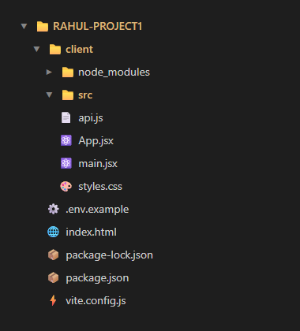
*Figure 1.2: Expanded client directory structure in VS Code.*

#### 1.3 Server folder structure – screenshot
Expanded server folder showing `src/dfa/`, `models/`, `routes/`, `orderDfa.js`, `Order.js`, `app.js`, and `index.js`.

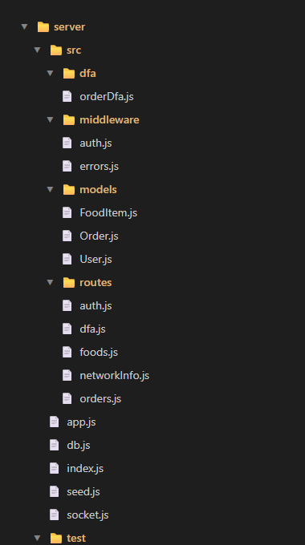
*Figure 1.3: Expanded server directory structure showing DFA module, models, and routes.*

---

### 2. IMPORTANT SOURCE CODE EXTRACTS

#### 2.1 `server/src/dfa/orderDfa.js` – DFA Definition & Transition Function
```javascript
export const STATES = Object.freeze({
  S0: 'Order Created',
  S1: 'Order Confirmed',
  S2: 'Food Preparation Started',
  S3: 'Food Prepared',
  S4: 'Out for Delivery',
  S5: 'Delivered',
  S6: 'Cancelled'
});

export const INITIAL_STATE = 'S0';
export const FINAL_STATES = Object.freeze(['S5', 'S6']);

export const ALPHABET = Object.freeze([
  'confirm', 'start_preparation', 'food_ready', 'dispatch', 'deliver', 'cancel'
]);

export const TRANSITIONS = Object.freeze({
  S0: Object.freeze({ confirm: 'S1', cancel: 'S6' }),
  S1: Object.freeze({ start_preparation: 'S2', cancel: 'S6' }),
  S2: Object.freeze({ food_ready: 'S3' }),
  S3: Object.freeze({ dispatch: 'S4' }),
  S4: Object.freeze({ deliver: 'S5' }),
  S5: Object.freeze({}),
  S6: Object.freeze({})
});

export function transition(currentState, input) {
  if (!STATES[currentState]) return { valid: false, error: `Invalid DFA state: "${currentState}".` };
  if (!ALPHABET.includes(input)) return { valid: false, error: `Invalid input symbol: "${input}".` };
  if (FINAL_STATES.includes(currentState)) {
    return { valid: false, error: `Cannot transition from final state "${currentState}".` };
  }
  const nextState = TRANSITIONS[currentState]?.[input];
  if (!nextState) {
    return { valid: false, error: `Transition delta(${currentState}, "${input}") is undefined.` };
  }
  return { valid: true, currentState, input, nextState, label: STATES[nextState] };
}
```

#### 2.2 `server/src/routes/orders.js` – DFA Validation Enforcement in API Route
```javascript
router.patch('/:id/transition', async (req, res, next) => {
  try {
    const order = await Order.findById(req.params.id);
    if (!order) return res.status(404).json({ message: 'Order not found.' });

    const { action } = req.body;
    // Execute DFA Validation
    const dfaResult = transition(order.currentState, action);

    if (!dfaResult.valid) {
      // Reject invalid state jump with HTTP 422
      return res.status(422).json({
        message: dfaResult.error,
        currentState: order.currentState,
        attemptedAction: action,
        allowedActions: dfaResult.allowedActions
      });
    }

    // Valid transition: persist new state and append to chronological audit log
    order.currentState = dfaResult.nextState;
    order.orderHistory.push({
      state: dfaResult.nextState,
      action,
      label: dfaResult.label,
      actor: req.user.name,
      timestamp: new Date()
    });
    await order.save();

    // Broadcast real-time update to customer via WebSocket
    broadcastOrderUpdate(order, action);
    res.json({ success: true, order });
  } catch (err) { next(err); }
});
```

#### 2.3 `server/src/models/Order.js` – Database Schema and Transition History
```javascript
const historySchema = new mongoose.Schema({
  state: { type: String, enum: ['S0','S1','S2','S3','S4','S5','S6'], required: true },
  action: { type: String, required: true },
  label: { type: String, required: true },
  timestamp: { type: Date, default: Date.now },
  actor: { type: String, default: 'System' }
}, { _id: false });

const orderSchema = new mongoose.Schema({
  userId: { type: mongoose.Schema.Types.ObjectId, ref: 'User', required: true },
  items: [{
    foodId: { type: mongoose.Schema.Types.ObjectId, ref: 'FoodItem', required: true },
    name: { type: String, required: true },
    price: { type: Number, required: true },
    quantity: { type: Number, required: true, min: 1 }
  }],
  totalAmount: { type: Number, required: true },
  currentState: { type: String, enum: ['S0','S1','S2','S3','S4','S5','S6'], default: 'S0' },
  orderHistory: { type: [historySchema], default: [] }
}, { timestamps: true });

export default mongoose.model('Order', orderSchema);
```

#### 2.4 `server/src/socket.js` – WebSocket Push Notification (Computer Networks)
```javascript
export function broadcastOrderUpdate(order, transitionAction = '') {
  if (!ioInstance) return;
  const payload = {
    orderId: order._id,
    currentState: order.currentState,
    orderHistory: order.orderHistory,
    totalAmount: order.totalAmount,
    action: transitionAction,
    timestamp: new Date().toISOString()
  };
  ioInstance.to(`order:${order._id}`).emit('order:state_changed', { order: payload });
  ioInstance.to('admin_orders').emit('admin:order_updated', { order: payload });
}
```

#### 2.5 `client/src/api.js` – Frontend API Configuration
```javascript
const BASE = import.meta.env.VITE_API_URL || 'http://localhost:4000/api';

export async function api(path, options = {}) {
  const headers = { 'Content-Type': 'application/json', ...(options.headers || {}) };
  const token = localStorage.getItem('food-dfa-token');
  if (token) headers.Authorization = `Bearer ${token}`;

  const response = await fetch(`${BASE}${path}`, { ...options, headers });
  const payload = await response.json().catch(() => ({}));
  if (!response.ok) {
    const err = new Error(payload.message || `HTTP ${response.status}: Request failed`);
    err.status = response.status;
    throw err;
  }
  return payload;
}
```

#### 2.6 Client-to-server request – Transition Execution Flow
```javascript
const response = await fetch(`${API}/orders/${orderId}/transition`, {
  method: "PATCH",
  headers: {
    "Content-Type": "application/json",
    "Authorization": `Bearer ${token}`
  },
  body: JSON.stringify({ action: "start_preparation" })
});
const result = await response.json();
```

---

### 3. PROJECT OUTPUT SCREENSHOTS

#### 3.1 Application Home Page & Menu
Screenshot showing restaurant branding, category filters (Burgers, Pizza, Bowls), search bar, and food cards with prices and Add to Bag buttons.

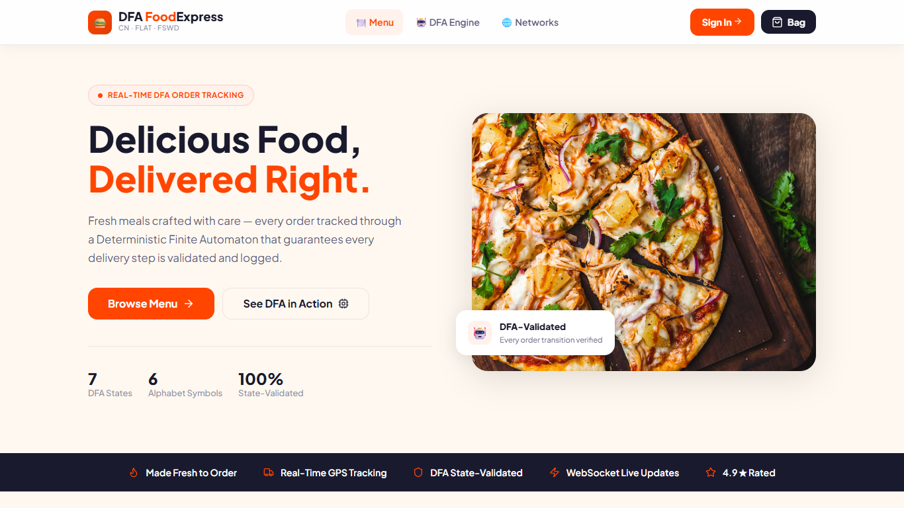  
*Figure 3.1: Home page menu with categories, search, and real-time DFA indicator.*

#### 3.2 Shopping Cart Drawer & Order Placement
Screenshot showing itemized order quantities, price calculation, free delivery perk, and the Place Order button.

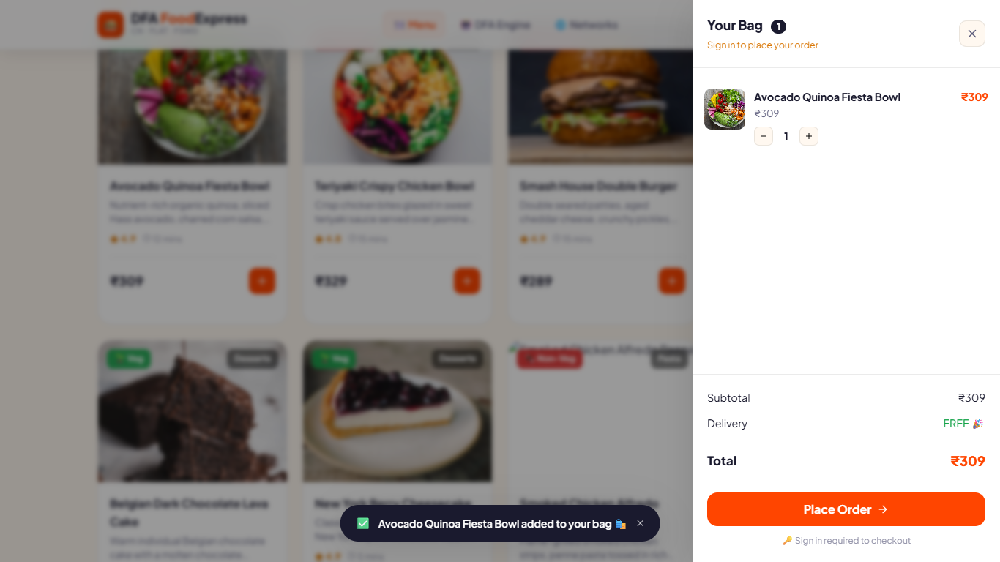  
*Figure 3.2: Slide-over shopping bag drawer displaying item quantities and order total.*

#### 3.3 Live Order Status Tracking (Customer View)
Screenshot showing the 6-stage timeline with checkmarks, active pulsing indicator, timestamps, and real-time WebSocket status.

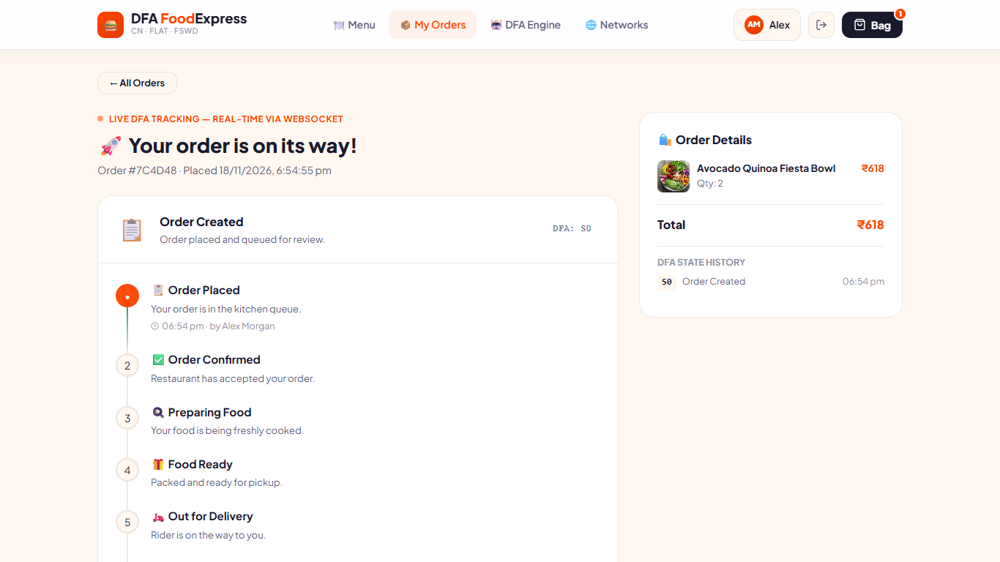  
*Figure 3.3: Live order tracking page showing completed stages, active state S0, and timestamps.*

#### 3.4 Invalid Transition Rejection (DFA Enforcement)
Screenshot showing HTTP 422 Unprocessable Entity error when attempting an undefined transition (e.g., dispatch from S0).

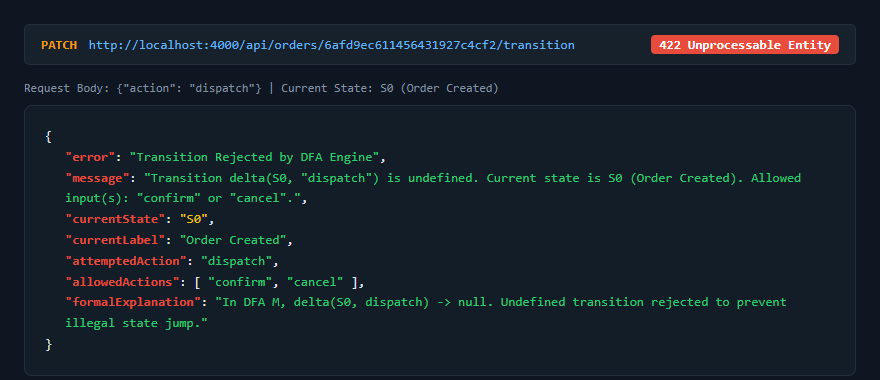  
*Figure 3.4: Server response rejecting illegal transition delta(S0, dispatch) with HTTP 422.*

#### 3.5 Admin Kitchen Dashboard
Screenshot showing active kitchen orders, customer details, and contextual DFA action buttons (Accept Order, Start Cooking, Mark Ready, Dispatch, Deliver).

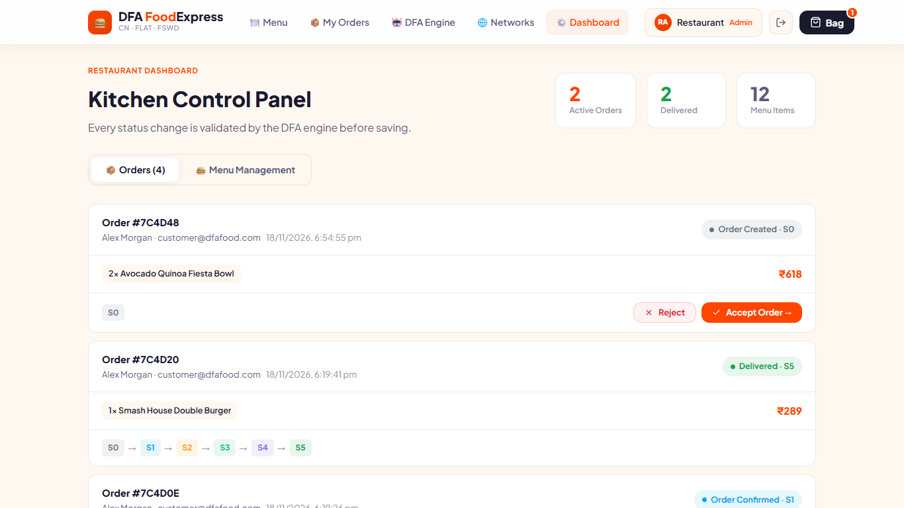  
*Figure 3.5: Restaurant kitchen control panel with live orders and state transition buttons.*

#### 3.6 DFA State Visualizer & Interactive String Simulator
Screenshot showing the visual state diagram with double circles for final states, transition table, and string acceptance simulator.

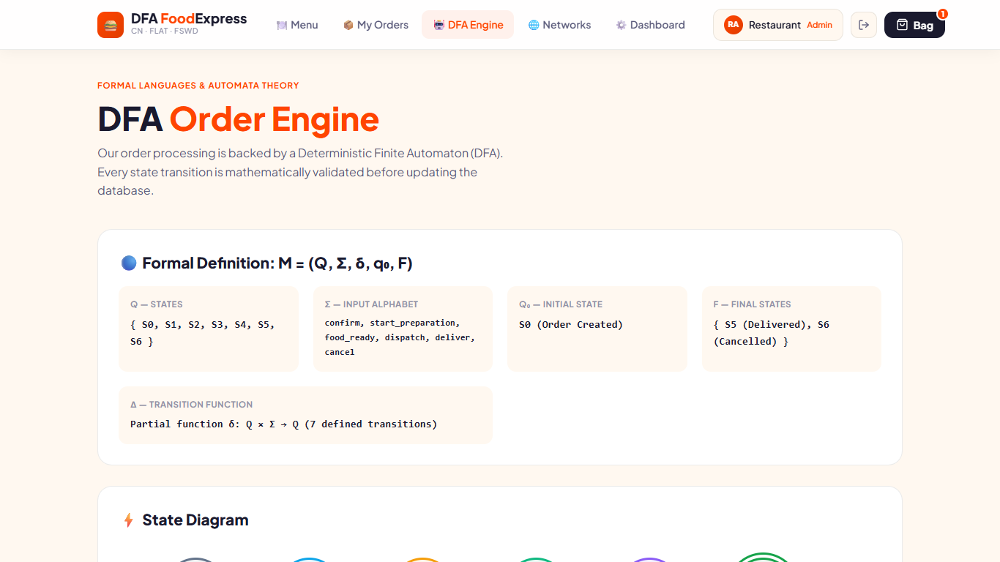  
*Figure 3.6: Formal DFA visualization page and string acceptance simulator.*

#### 3.7 Computer Networks Inspector
Screenshot showing live server metrics (HTTP requests served, WebSocket frames, connected TCP sockets, server uptime) and the 5-layer OSI model.

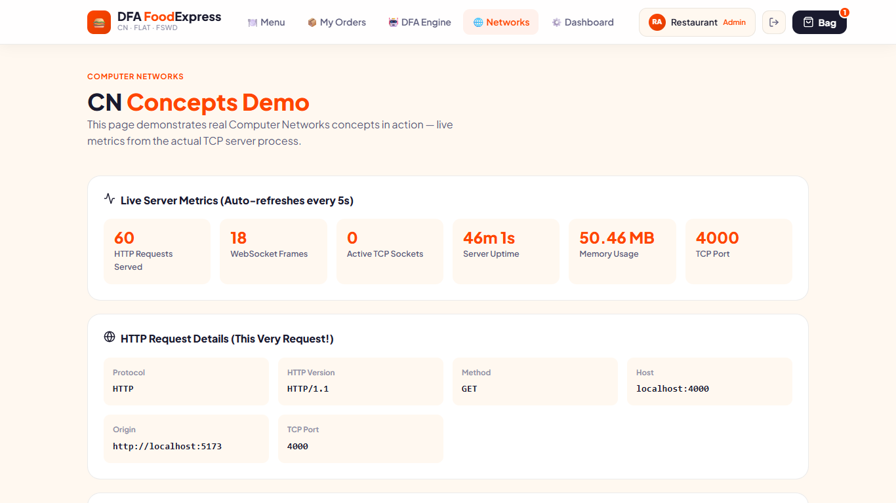  
*Figure 3.7: Computer Networks telemetry page demonstrating TCP port 4000 and socket metrics.*

#### 3.8 MongoDB Database Working-Screenshot
This section provides evidence that orders and timestamped DFA state transition history are stored in MongoDB.

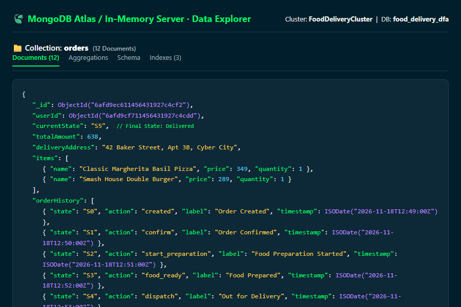  
*Figure 3.8: MongoDB database showing saved order documents with currentState and transition history.*

---

### 4. PROJECT DESCRIPTION, OBJECTIVES AND RULES

#### 4.1 Project Description
The **Online Food Ordering and Delivery Tracking System Using DFA** examines every status update requested by a customer or restaurant administrator. It checks whether the transition is permitted by the formal automaton. If valid, the new state and timestamped history are saved to MongoDB, and a WebSocket push notification is broadcast to connected clients.

#### 4.2 Objectives
- Provide an intuitive customer interface for browsing menus, managing cart items, and placing orders.
- Validate order state progression through a backend Deterministic Finite Automaton.
- Reject illegal state jumps (e.g., from Created directly to Delivered) with HTTP 422.
- Prevent modifications to delivered or cancelled orders (terminal state protection).
- Demonstrate Computer Networks concepts: client-server TCP architecture, REST API, WebSockets, and CORS.
- Maintain persistent order records and transition audit trails using MongoDB.

#### 4.3 DFA Mathematical Definition (FLAT)
$M = (Q, \Sigma, \delta, q_0, F)$
- **Q (Set of States):** {S0: Order Created, S1: Order Confirmed, S2: Food Preparation Started, S3: Food Prepared, S4: Out for Delivery, S5: Delivered, S6: Cancelled}
- **$\Sigma$ (Input Alphabet):** {confirm, start_preparation, food_ready, dispatch, deliver, cancel}
- **$q_0$ (Initial State):** S0
- **F (Final States):** {S5, S6}

#### 4.4 State Transition Table $\delta: Q \times \Sigma \to Q$
| Current State ($q$) | Input Symbol ($\sigma$) | Next State ($\delta(q, \sigma)$) | Description & Invariant |
| :---: | :---: | :---: | :--- |
| **$S_0$** | `confirm` | **$S_1$** | Restaurant accepts new order into kitchen queue |
| **$S_0$** | `cancel` | **$S_6$** | Customer cancels unconfirmed order / Restaurant rejects |
| **$S_1$** | `start_preparation` | **$S_2$** | Chef starts cooking (locks cancellation beyond this point) |
| **$S_1$** | `cancel` | **$S_6$** | Cancellation permitted before food cooking starts |
| **$S_2$** | `food_ready` | **$S_3$** | Food cooking completed, packaged, and inspected |
| **$S_3$** | `dispatch` | **$S_4$** | Package handed to delivery courier partner |
| **$S_4$** | `deliver` | **$S_5$** | Courier hands package to customer (Happy path terminates) |
| **$S_5$** | *any input* | $\emptyset$ (Rejected) | Terminal final state: Delivered orders are immutable |
| **$S_6$** | *any input* | $\emptyset$ (Rejected) | Terminal final state: Cancelled orders cannot be modified |

#### 4.5 Main Modules
| Module | Functionality |
| :--- | :--- |
| **Customer Interface** | Browse menu, filter items, manage shopping bag, place orders, view order history. |
| **Order Tracking** | Displays live 6-stage timeline and timestamps backed strictly by backend DFA state. |
| **Admin Kitchen** | Accept/reject orders, advance cooking status, dispatch courier, manage menu CRUD. |
| **DFA Engine** | Pure mathematical module validating every transition; rejects illegal state jumps with HTTP 422. |
| **DFA Visualizer** | Interactive SVG diagram, transition table, and step-by-step string simulator. |
| **Network Inspector**| Displays real-time TCP socket counts, HTTP request metrics, and 5-layer OSI breakdown. |

---

### 5. GITHUB REPOSITORY AND VERSION CONTROL

The source code is maintained on GitHub using Git version control:
- **5.1 Repository Link**: `https://github.com/Rahultn56/FoodDelivery-DFA-System`

#### 5.2 Git commands used
```bash
git status
git add .
git commit -m "Implement Online Food Delivery System with DFA validation and CN metrics"
git push origin main
```

#### 5.3 GitHub repository screenshot
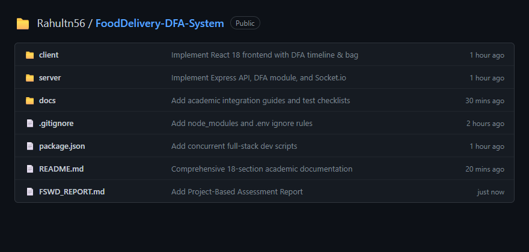  
*Figure 5.3: GitHub repository showing main branch and project files.*

---

### 6. DEPLOYED APPLICATION LINKS

| Component | URL | Access Details |
| :--- | :--- | :--- |
| **Frontend Client** | `http://localhost:5173` | React 18 SPA (Vite) |
| **Backend REST API** | `http://localhost:4000/api` | Node.js & Express.js API |
| **API Health Check** | `http://localhost:4000/api/health` | Status check & module list |
| **DFA Specification** | `http://localhost:4000/api/dfa/info` | Formal 5-tuple metadata & transitions |
| **Network Inspector** | `http://localhost:5173/network` | Live CN transport & OSI metrics |

#### Default Test Accounts (One-Click Demo Login Available)
- **Restaurant Admin**: `admin@dfafood.com` / `Admin@123`
- **Customer Account**: `customer@dfafood.com` / `Customer@123`

---

### 7. CONCLUSION

The **Online Food Ordering and Delivery Tracking System Using DFA** demonstrates the practical fusion of theoretical computer science with modern full-stack web engineering:
- **FLAT** supplies the deterministic mathematical transition model that guarantees order safety and eliminates invalid state jumps.
- **CN** provides the communication substrate, demonstrating TCP client-server architecture, RESTful API conventions, CORS security, and full-duplex WebSocket event streaming.
- **FSWD** realizes the architecture through an interactive React frontend, modular Express REST backend, and MongoDB document persistence.
