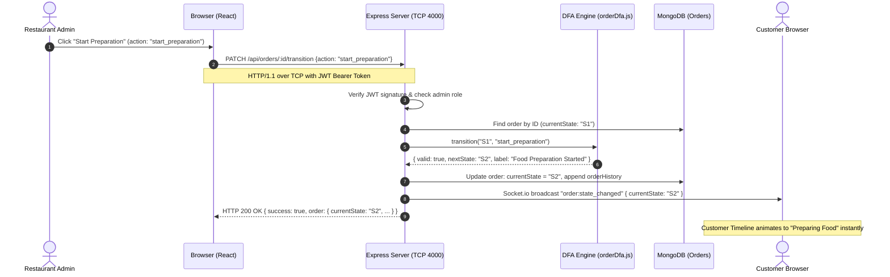
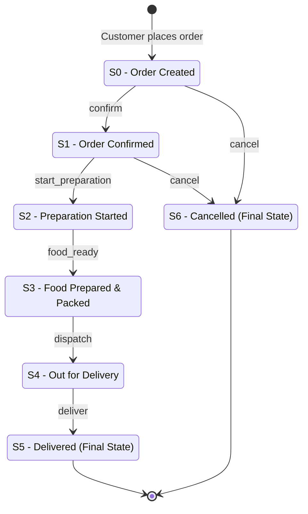

# Online Food Ordering and Delivery Tracking System Using DFA

> **Academic Integration Project** combining:
> - **Computer Networks (CN)**
> - **Formal Languages and Automata Theory (FLAT)**
> - **Full Stack Web Development (FSWD)**

[](https://nodejs.org/)
[](https://expressjs.com/)
[](https://react.dev/)
[](https://www.mongodb.com/)
[](https://socket.io/)
[-orange.svg)]()
[]()

---

## Table of Contents

1. [Project Introduction](#1-project-introduction)
2. [Problem Statement](#2-problem-statement)
3. [Objectives](#3-objectives)
4. [System Architecture](#4-system-architecture)
5. [Technologies Used](#5-technologies-used)
6. [Computer Networks (CN) Concepts Implemented](#6-computer-networks-cn-concepts-implemented)
7. [Formal Languages and Automata Theory (FLAT) Concepts Implemented](#7-formal-languages-and-automata-theory-flat-concepts-implemented)
8. [DFA Mathematical Definition](#8-dfa-mathematical-definition)
9. [DFA State Transition Table](#9-dfa-state-transition-table)
10. [DFA State Diagram](#10-dfa-state-diagram)
11. [Full Stack Web Development (FSWD) Concepts Implemented](#11-full-stack-web-development-fswd-concepts-implemented)
12. [Database Design](#12-database-design)
13. [API Documentation with Examples](#13-api-documentation-with-examples)
14. [Installation Instructions](#14-installation-instructions)
15. [How to Run the Application](#15-how-to-run-the-application)
16. [Screenshots and UI Walkthrough](#16-screenshots-and-ui-walkthrough)
17. [Future Enhancements](#17-future-enhancements)
18. [Conclusion and Viva Preparation](#18-conclusion-and-viva-preparation)

---

## 1. Project Introduction

**Online Food Ordering and Delivery Tracking System Using DFA** is a full-stack web application engineered for college academic demonstration and viva assessment. The application simulates a commercial online food delivery platform (such as Swiggy, Zomato, or Uber Eats) while grounding its mission-critical order processing pipeline in formal mathematical computer science.

Rather than treating status updates as arbitrary string variables that any frontend can manipulate, the entire lifecycle of an order is strictly governed by a **Deterministic Finite Automaton (DFA)** on the backend server. The application integrates:
- **Computer Networks (CN)**: Multi-tier client-server architecture, HTTP/1.1 REST endpoints, persistent full-duplex TCP WebSockets via Socket.io, JSON serialization, CORS security policies, and 5-layer protocol stack inspection.
- **Formal Languages and Automata Theory (FLAT)**: 5-tuple mathematical definition $M = (Q, \Sigma, \delta, q_0, F)$, deterministic transition function $\delta$, partial function enforcement, rejection of state-skipping and terminal mutation, and formal language acceptance $L(M)$.
- **Full Stack Web Development (FSWD)**: React 18 Single-Page Application (SPA) with Vite, responsive design, JWT authentication, bcrypt password hashing, role-based access control (RBAC), and MongoDB database modeling.

---

## 2. Problem Statement

In conventional food ordering systems, order state management is typically implemented through primitive database columns containing arbitrary status strings (e.g., `"placed"`, `"preparing"`, `"delivered"`). This ad-hoc implementation introduces critical software engineering and security defects:
1. **Illegal State Jumping**: A client or malicious user could issue a request changing an order directly from `"Created"` to `"Delivered"`, bypassing cooking and courier dispatch.
2. **Post-Terminal Mutation**: An order marked as `"Delivered"` or `"Cancelled"` might still be modified or re-dispatched, leading to restaurant financial discrepancies.
3. **Unenforceable Invariants**: In the absence of a mathematically proven transition model, server controllers require brittle, error-prone nested `if-else` clauses that are difficult to verify and test.

**The Solution:** Model and implement order fulfillment as a formal **Deterministic Finite Automaton (DFA)**. Every status transition is mathematically validated as $\delta(q_{\text{current}}, \sigma_{\text{input}}) = q_{\text{next}}$. Any input symbol not explicitly defined in the transition function $\delta$ is strictly rejected with an HTTP `422 Unprocessable Entity` status code and a mathematical rejection proof.

---

## 3. Objectives

- **Primary Objective**: Build a robust, end-to-end food delivery web application where every order lifecycle transition is validated by a backend DFA engine.
- **CN Objective**: Demonstrate client-server request-response cycles, TCP 3-way handshake mechanisms, HTTP methods, status code semantics, CORS policies, and compare periodic HTTP polling with real-time WebSocket push updates.
- **FLAT Objective**: Provide an executable implementation of $M = (Q, \Sigma, \delta, q_0, F)$, including an interactive SVG state diagram, transition table, string simulator, and automated test suite.
- **FSWD Objective**: Deliver a production-grade web application with React components, client-side routing, shopping bag state management, JWT authentication, and MongoDB persistence.
- **Portability Objective**: Support zero-friction evaluation through an automatic **In-Memory MongoDB fallback**, ensuring the project runs instantly on any evaluator's computer without requiring manual database installation.

---

## 4. System Architecture

```mermaid
flowchart TD
    subgraph Client_Tier [Client Tier: Browser]
        UI[React 18 SPA + Vite]
        RT[React Router v6]
        SOCK_C[Socket.io Client]
        HTTP_C[Fetch REST API Client]
    end

    subgraph Transport_Layer [Transport Layer: TCP / IP]
        TCP_P4000[TCP Port 4000 Connection]
    end

    subgraph Server_Tier [Server Tier: Node.js + Express]
        SRV[HTTP / Express Server]
        AUTH[JWT & Bcrypt Auth Middleware]
        SOCK_S[Socket.io Server]
        DFA[FLAT: DFA Validation Engine]
        ROUTER[REST API Routes]
    end

    subgraph Data_Tier [Persistence Tier: MongoDB]
        MDB[(MongoDB / In-Memory Server)]
        U_COL[Users Collection]
        F_COL[FoodItems Collection]
        O_COL[Orders Collection]
    end

    UI -->|Route Selection| RT
    UI -->|JSON Payloads| HTTP_C
    UI <-->|Bidirectional Frames| SOCK_C
    HTTP_C -->|HTTP GET/POST/PATCH/DELETE| TCP_P4000
    SOCK_C <-->|WebSocket Stream (ws://)| TCP_P4000
    TCP_P4000 --> SRV
    SRV --> AUTH
    AUTH --> ROUTER
    ROUTER -->|delta validation| DFA
    DFA -->|valid / invalid| ROUTER
    ROUTER -->|Mongoose Queries| MDB
    MDB --> U_COL
    MDB --> F_COL
    MDB --> O_COL
    SRV <--> SOCK_S
    SOCK_S -.->|order:state_changed| SOCK_C
```

### End-to-End Request-Response Sequence



---

## 5. Technologies Used

| Category | Technology | Version | Purpose in Project |
| :--- | :--- | :--- | :--- |
| **Frontend** | React.js | 18.3.1 | Component-based interactive User Interface |
| **Frontend Tooling** | Vite | 6.0.7 | Modern HMR build tool and dev server |
| **Routing** | React Router DOM | 6.28.1 | Declarative client-side routing and deep linking |
| **Icons** | Lucide React | 0.468.0 | Clean iconography for UI actions and indicators |
| **Styling** | Custom Responsive CSS | CSS3 | Responsive grid, custom properties, micro-animations |
| **Backend Runtime** | Node.js | v20+ / v26 | Asynchronous, event-driven JavaScript server environment |
| **Backend Framework**| Express.js | 4.21.2 | REST API routing, middleware chaining, JSON parsing |
| **Database** | MongoDB & Mongoose | 8.9.5 | NoSQL object document modeling and ACID document writes |
| **Database Fallback** | MongoDB Memory Server | 11.3.0 | Zero-setup in-memory database for instant evaluation |
| **Authentication** | JSON Web Tokens (JWT) | 9.0.2 | Stateless signed bearer authentication tokens |
| **Cryptography** | bcryptjs | 2.4.3 | Salted password hashing (one-way cryptographic hash) |
| **Networking** | Socket.io | 4.8.1 | Persistent WebSocket full-duplex TCP event streaming |
| **Cross-Origin** | CORS | 2.8.5 | Cross-Origin Resource Sharing policy configuration |
| **Environment** | dotenv | 16.4.7 | Server configuration via environment variables |
| **Testing** | Node.js Test Runner | Native `node:test` | Formal mathematical verification of DFA state transitions |

---

## 6. Computer Networks (CN) Concepts Implemented

The application demonstrates practical Computer Networks concepts across multiple layers:

### 1. Client-Server Architecture
- **Client (Frontend)**: Runs inside the user's browser, responsible for presentation, user interaction, client-side input validation, and dispatching asynchronous requests.
- **Server (Backend)**: Runs as an independent Node.js process listening on TCP port `4000`, responsible for authentication, business logic, DFA state transition validation, and database access.

### 2. TCP/IP Socket Layer & 3-Way Handshake
Before any HTTP or WebSocket data exchange occurs, a TCP connection is established between the browser client and server via the standard 3-way handshake:
1. **SYN**: Client sends a Synchronize packet with an initial sequence number ($ISN_c$) to server port 4000.
2. **SYN-ACK**: Server responds with Synchronize-Acknowledgment packet containing $ISN_s$ and $ACK = ISN_c + 1$.
3. **ACK**: Client replies with Acknowledgment packet with $ACK = ISN_s + 1$. The reliable, full-duplex TCP socket is now established.

### 3. RESTful HTTP Methods
The API strictly adheres to REST principles using proper semantic HTTP verbs:
- `GET`: Safe, idempotent retrieval of resources (menu items, orders, DFA metadata, network stats).
- `POST`: Non-idempotent creation of new resources (customer registration, authentication session, placing orders).
- `PATCH`: Partial modification of an existing resource (executing a DFA state transition on an order).
- `DELETE`: Removal of a resource (admin deleting a food item).

### 4. HTTP Status Codes
Every API response communicates outcome semantics through standardized status codes:
- `200 OK`: Successful read or update operation.
- `201 Created`: Resource successfully created (order placed, user registered).
- `400 Bad Request`: Malformed JSON payload or missing mandatory parameters.
- `401 Unauthorized`: Missing, invalid, or expired JWT bearer token.
- `403 Forbidden`: Authenticated user lacks permission (customer attempting kitchen action).
- `404 Not Found`: Target resource or endpoint does not exist.
- `409 Conflict`: Duplicate resource violation (registering an already-registered email).
- `422 Unprocessable Entity`: **DFA Rule Violation** — Requested state transition is undefined or illegal.
- `500 Internal Server Error`: Unexpected server-side exception.

### 5. CORS (Cross-Origin Resource Sharing)
Since the client runs on port `5173` (Vite) and the server listens on port `4000` (Express), browsers enforce the Same-Origin Policy (SOP). The server configures the `cors` middleware to issue response headers (`Access-Control-Allow-Origin`, `Access-Control-Allow-Methods`, `Access-Control-Allow-Headers`), granting permission to authorized origins.

### 6. Real-Time Push vs. Polling (WebSocket vs. HTTP)
The project demonstrates and compares two fundamental networking paradigms:
- **HTTP Polling (Pull)**: The client periodically queries `GET /api/orders/:id` every 5 seconds over independent HTTP request-response cycles.
- **WebSockets via Socket.io (Push)**: The client upgrades the HTTP connection to a persistent full-duplex TCP stream (`101 Switching Protocols`). When an order state transition occurs, the server pushes an `order:state_changed` event instantly without client-initiated round-trips.

### 7. Interactive Network Inspector (`/network`)
The frontend contains an interactive **Computer Networks Inspector** tab that displays:
- Live request and frame counters.
- Connected TCP socket client counts.
- Uptime and memory footprint.
- Active network interface IPs and netmasks.
- Visual diagram of the 5-Layer OSI / TCP-IP model.

---

## 7. Formal Languages and Automata Theory (FLAT) Concepts Implemented

The core algorithmic differentiator of this application is its strict adherence to formal language theory:

### 1. The Automaton Abstraction
Order processing is modeled as a language recognition and state transformation problem. The order moves through states based on input alphabet tokens emitted by authorized actors (Customer or Kitchen Staff).

### 2. Transition Function as a Partial Function
In formal automata theory, a transition function $\delta: Q \times \Sigma \to Q$ can be total or partial. Here, $\delta$ is intentionally a **partial function**:
- Defined transitions represent valid physical operations (e.g., confirming, cooking, packing, delivering).
- Undefined transitions represent physically impossible or forbidden actions (e.g., delivering before preparing, or cooking before confirming).
- If $\delta(q, \sigma) = \text{undefined}$, the machine halts the transition, rejects the input symbol, and preserves the current state.

### 3. Protection of Terminal States ($F$)
Final / accepting states $F = \{S_5, S_6\}$ represent completed lifecycles. Mathematically:
$$\forall \sigma \in \Sigma, \quad \delta(S_5, \sigma) = \emptyset \quad \text{and} \quad \delta(S_6, \sigma) = \emptyset$$
Once an order reaches $S_5$ (Delivered) or $S_6$ (Cancelled), no further action can alter its state.

### 4. Language of Valid Orders $L(M)$
The formal language $L(M)$ accepted by the automaton represents the set of all valid operational sequences:
$$L(M) = \{ w \in \Sigma^* \mid \delta^*(q_0, w) \in F \}$$

Specifically:
$$L(M) = \{ \text{confirm} \cdot \text{start\_preparation} \cdot \text{food\_ready} \cdot \text{dispatch} \cdot \text{deliver}, \quad \text{cancel}, \quad \text{confirm} \cdot \text{cancel} \}$$

Any input string not matching these valid prefix sequences is rejected by the automaton.

---

## 8. DFA Mathematical Definition

The order processing engine is formally defined as a 5-tuple:

$$M = (Q, \Sigma, \delta, q_0, F)$$

Where:

### 1. Set of States ($Q$)
$$Q = \{S_0, S_1, S_2, S_3, S_4, S_5, S_6\}$$

- $S_0$: **Order Created** (Initial state when customer places order)
- $S_1$: **Order Confirmed** (Restaurant has reviewed and accepted order)
- $S_2$: **Food Preparation Started** (Chef has commenced cooking)
- $S_3$: **Food Prepared** (Dish is cooked, quality-checked, and packaged)
- $S_4$: **Out for Delivery** (Courier has picked up package and is en route)
- $S_5$: **Delivered** (Package handed over to customer — Final State)
- $S_6$: **Cancelled** (Order cancelled or rejected — Final State)

### 2. Input Alphabet ($\Sigma$)
$$\Sigma = \{ \text{confirm}, \, \text{start\_preparation}, \, \text{food\_ready}, \, \text{dispatch}, \, \text{deliver}, \, \text{cancel} \}$$

### 3. Initial State ($q_0$)
$$q_0 = S_0$$

### 4. Set of Final / Accepting States ($F$)
$$F = \{S_5, S_6\}$$

### 5. Transition Function ($\delta$)
$$\delta: Q \times \Sigma \to Q$$
Defined explicitly in the transition table below.

---

## 9. DFA State Transition Table

| Current State ($q$) | Input Symbol ($\sigma \in \Sigma$) | Next State ($\delta(q, \sigma)$) | Description & Invariant |
| :---: | :---: | :---: | :--- |
| **$S_0$** | `confirm` | **$S_1$** | Restaurant accepts new order into kitchen queue |
| **$S_0$** | `cancel` | **$S_6$** | Customer cancels unconfirmed order OR Restaurant rejects it |
| **$S_1$** | `start_preparation` | **$S_2$** | Kitchen staff begins food preparation |
| **$S_1$** | `cancel` | **$S_6$** | Cancellation permitted before cooking begins |
| **$S_2$** | `food_ready` | **$S_3$** | Food cooking complete and packaged. Cannot cancel past this point |
| **$S_3$** | `dispatch` | **$S_4$** | Package handed to delivery courier partner |
| **$S_4$** | `deliver` | **$S_5$** | Courier hands package to customer. Happy path terminates |
| **$S_5$** | *any input* | $\emptyset$ (Rejected) | Final State: Delivered orders cannot be modified |
| **$S_6$** | *any input* | $\emptyset$ (Rejected) | Final State: Cancelled orders cannot be revived |

*Note: Any cell $(q, \sigma)$ omitted from this table evaluates to $\emptyset$ (undefined) and triggers an HTTP 422 rejection.*

---

## 10. DFA State Diagram

### Mermaid State Diagram


### ASCII State Diagram
```text
  [START]
     │
     ▼
  ┌──────┐    confirm      ┌──────┐ start_preparation ┌──────┐
  │  S0  │ ──────────────> │  S1  │ ────────────────> │  S2  │
  └──────┘                 └──────┘                   └──────┘
     │                        │                          │
     │ cancel                 │ cancel                   │ food_ready
     ▼                        ▼                          ▼
  ┌──────┐                 ┌──────┐                   ┌──────┐
  │((S6))│ <───────────────┘  S6  │                   │  S3  │
  │Cancelled               │      │                   └──────┘
  └──────┘                 └──────┘                      │
     ▲                                                   │ dispatch
     │                                                   ▼
     │                                                ┌──────┐
  (Final)                                             │  S4  │
                                                      └──────┘
                                                         │
                                                         │ deliver
                                                         ▼
                                                      ┌──────┐
                                                      │((S5))│
                                                      │Delivered
                                                      └──────┘ (Final)
```

---

## 11. Full Stack Web Development (FSWD) Concepts Implemented

1. **Component-Based Architecture**:
   - Modular, single-responsibility React components (`Navbar`, `FoodCard`, `CartDrawer`, `Timeline`, `AdminOrderCard`, `NetworkStats`).
2. **Client-Side Routing**:
   - React Router v6 providing deep URLs without page reloads (`/`, `/login`, `/register`, `/orders`, `/orders/:id`, `/admin`, `/dfa`, `/network`).
3. **State Management**:
   - React hooks (`useState`, `useEffect`, `useCallback`, `useMemo`, `useRef`) managing application lifecycle, local bag caching, and live WebSocket subscriptions.
4. **Authentication & Authorization**:
   - JWT tokens signed with HMAC-SHA256 containing user ID and role claims.
   - Password hashing with `bcryptjs` using 10 salt rounds.
   - Dual-tier Role-Based Access Control (RBAC): `customer` vs. `admin`.
5. **Database Abstraction & Relationships**:
   - Mongoose schemas modeling document relationships with `ObjectId` references (`Order.userId -> User`, `Order.items.foodId -> FoodItem`).
   - Snapshot preservation: Item name and purchase price are copied directly into the order record, ensuring historical order totals remain immutable even if menu prices change later.
6. **Form Validation & UX**:
   - Client and server-side validation on email formats, password minimum lengths, item quantities (1–50), and required fields.
   - Non-blocking toast notification feedback with auto-dismissal.

---

## 12. Database Design

### Collection: `users`
| Field | Type | Constraint | Description |
| :--- | :--- | :--- | :--- |
| `_id` | ObjectId | Primary Key | Unique user identifier |
| `name` | String | Required, max 80 | Full name of user |
| `email` | String | Required, Unique, Lowercase | User email address (login credential) |
| `password` | String | Required, Hashed | bcrypt salted hash (hidden from select by default) |
| `role` | String | Enum: `['customer', 'admin']` | Authorization role |
| `address` | String | Default: Baker St | Default delivery street address |
| `phone` | String | Default: Phone | Contact telephone number |
| `createdAt` | Date | Auto Timestamp | Account registration timestamp |
| `updatedAt` | Date | Auto Timestamp | Last profile update timestamp |

### Collection: `fooditems`
| Field | Type | Constraint | Description |
| :--- | :--- | :--- | :--- |
| `_id` | ObjectId | Primary Key | Unique food item identifier |
| `name` | String | Required, Trimmed | Name of the dish |
| `description` | String | Required, Trimmed | Detailed ingredients and culinary description |
| `price` | Number | Required, Min: 0 | Price in INR (₹) |
| `category` | String | Required | Menu category (Burgers, Pizza, Pasta, Bowls, Sides, Desserts) |
| `image` | String | URL | High-resolution food photograph URL |
| `availability`| Boolean | Default: `true` | In-stock toggle for kitchen inventory control |
| `isVeg` | Boolean | Default: `true` | Vegetarian indicator |
| `rating` | Number | Default: `4.8` | Customer review rating |
| `prepTimeMinutes`| Number| Default: `15` | Average kitchen preparation time |

### Collection: `orders`
| Field | Type | Constraint | Description |
| :--- | :--- | :--- | :--- |
| `_id` | ObjectId | Primary Key | Unique order identifier |
| `userId` | ObjectId | Ref: `User`, Required, Index | Purchasing customer reference |
| `items` | Array of Objects | Min: 1 item | Line items: `{ foodId, name, price, quantity, image }` |
| `totalAmount` | Number | Required, Min: 0 | Calculated sum of (price × quantity) |
| `deliveryAddress`| String | Required | Physical destination for courier |
| `customerPhone` | String | Required | Customer contact number |
| `currentState` | String | Enum: `S0`..`S6`, Default: `S0`| Current DFA state code |
| `orderHistory` | Array of Objects | Chronological log | Transition history entries (see below) |
| `createdAt` | Date | Auto Timestamp | Order creation timestamp |
| `updatedAt` | Date | Auto Timestamp | Last state transition timestamp |

#### Sub-document: `orderHistory`
```json
{
  "state": "S2",
  "action": "start_preparation",
  "label": "Food Preparation Started",
  "timestamp": "2026-11-18T12:49:08.123Z",
  "actor": "Restaurant Admin",
  "actorRole": "admin",
  "notes": "Chef has started cooking food. Cannot be cancelled beyond this point."
}
```

---

## 13. API Documentation with Examples

Base URL: `http://localhost:4000/api`

### 1. Authentication Endpoints

#### Register Customer
```http
POST /api/auth/register
Content-Type: application/json

{
  "name": "Rahul G",
  "email": "rahul.g@example.com",
  "password": "Password123"
}
```
**Response (201 Created):**
```json
{
  "token": "eyJhbGciOiJIUzI1NiIsInR5cCI6IkpXVCJ9...",
  "user": {
    "id": "6afd9cf711456431927c4cdd",
    "name": "Rahul G",
    "email": "rahul.g@example.com",
    "role": "customer"
  }
}
```

#### User Login
```http
POST /api/auth/login
Content-Type: application/json

{
  "email": "admin@dfafood.com",
  "password": "Admin@123"
}
```
**Response (200 OK):**
```json
{
  "token": "eyJhbGciOiJIUzI1NiIsInR5cCI6IkpXVCJ9...",
  "user": {
    "id": "6afd9cf711456431927c4cdb",
    "name": "Restaurant Admin",
    "email": "admin@dfafood.com",
    "role": "admin"
  }
}
```

---

### 2. Food Menu Endpoints

#### Retrieve Menu Items (with Search & Category Filters)
```http
GET /api/foods?category=Burgers&search=truffle
```
**Response (200 OK):**
```json
{
  "items": [
    {
      "_id": "6afd9cf711456431927c4ce0",
      "name": "Truffle Mushroom & Swiss Burger",
      "description": "Crisp plant patty with sauteed garlic wild mushrooms...",
      "price": 299,
      "category": "Burgers",
      "isVeg": true,
      "availability": true,
      "rating": 4.8
    }
  ]
}
```

---

### 3. Order Management Endpoints

#### Place Order (Initializes in $S_0$)
```http
POST /api/orders
Authorization: Bearer <Customer_JWT_Token>
Content-Type: application/json

{
  "items": [
    { "foodId": "6afd9cf711456431927c4ce0", "quantity": 2 }
  ],
  "deliveryAddress": "Hostel Block C, Room 304, Campus",
  "customerPhone": "+91 98765 43210"
}
```
**Response (201 Created):**
```json
{
  "order": {
    "_id": "6afd9ec611456431927c4cf2",
    "userId": "6afd9cf711456431927c4cdb",
    "currentState": "S0",
    "totalAmount": 598,
    "orderHistory": [
      {
        "state": "S0",
        "action": "created",
        "label": "Order Created",
        "actor": "Rahul G",
        "timestamp": "2026-11-18T12:49:00.000Z"
      }
    ]
  },
  "dfaState": {
    "currentState": "S0",
    "label": "Order Created",
    "allowedActions": ["confirm", "cancel"]
  }
}
```

#### Execute DFA State Transition (Admin or Owner Cancel)
```http
PATCH /api/orders/6afd9ec611456431927c4cf2/transition
Authorization: Bearer <Admin_JWT_Token>
Content-Type: application/json

{
  "action": "confirm"
}
```
**Response (200 OK — Valid Transition):**
```json
{
  "success": true,
  "order": {
    "_id": "6afd9ec611456431927c4cf2",
    "currentState": "S1",
    "orderHistory": [
      { "state": "S0", "action": "created", "label": "Order Created" },
      { "state": "S1", "action": "confirm", "label": "Order Confirmed", "actor": "Restaurant Admin" }
    ]
  },
  "dfaTransition": {
    "fromState": "S0",
    "action": "confirm",
    "toState": "S1",
    "label": "Order Confirmed",
    "formalExplanation": "delta(S0, confirm) = S1 (Order Confirmed)",
    "isFinal": false
  }
}
```

#### Rejection of Invalid DFA Transition
If an admin attempts to dispatch an order that is still in state $S_0$:
```http
PATCH /api/orders/6afd9ec611456431927c4cf2/transition
Authorization: Bearer <Admin_JWT_Token>
Content-Type: application/json

{
  "action": "dispatch"
}
```
**Response (422 Unprocessable Entity — Rejection Proof):**
```json
{
  "message": "Transition delta(S0, \"dispatch\") is undefined. Current state is S0 (Order Created). Allowed input(s): \"confirm\" or \"cancel\".",
  "currentState": "S0",
  "currentLabel": "Order Created",
  "attemptedAction": "dispatch",
  "allowedActions": ["confirm", "cancel"],
  "formalExplanation": "In DFA M, delta(S0, dispatch) -> null. Undefined transition rejected to prevent illegal state jump."
}
```

---

## 14. Installation Instructions

### Prerequisites
- **Node.js**: v18.0.0 or later (v20+ recommended). Check with `node -v`.
- **npm**: v9.0.0 or later. Check with `npm -v`.
- **MongoDB** *(Optional)*: If you have a local MongoDB service or MongoDB Atlas URI, specify it in `server/.env`. **If you do not have MongoDB installed, the application automatically boots an embedded in-memory MongoDB server!**

### Step-by-Step Setup

1. **Clone or Navigate to the Project Root**:
   ```bash
   cd c:\Users\gr777\Downloads\RAHUL-PROJECT1
   ```

2. **Install Root, Server, and Client Dependencies**:
   ```bash
   npm run install:all
   ```
   *(Or individually: `npm install`, `cd server && npm install`, `cd ../client && npm install`)*

3. **Configure Environment Variables**:
   Copy the example environment files if they do not exist:
   ```bash
   # Windows PowerShell
   Copy-Item server/.env.example server/.env -Force
   Copy-Item client/.env.example client/.env -Force
   ```

   The default `server/.env` comes pre-configured with:
   ```env
   PORT=4000
   MONGODB_URI=mongodb://127.0.0.1:27017/food_delivery_dfa
   JWT_SECRET=super_secret_jwt_key_dfa_food_delivery_system_2026_academic_demo
   CLIENT_ORIGIN=http://localhost:5173
   ADMIN_EMAIL=admin@dfafood.com
   ADMIN_PASSWORD=Admin@123
   DEMO_CUSTOMER_EMAIL=customer@dfafood.com
   DEMO_CUSTOMER_PASSWORD=Customer@123
   ```

---

## 15. How to Run the Application

### Option A: Run Full-Stack Concurrently (Recommended)
From the project root directory:
```bash
npm run dev
```
This boots both the Express server (port 4000) and the Vite client (port 5173) simultaneously.

### Option B: Run Server and Client in Separate Terminals

**Terminal 1 — Backend API**:
```bash
npm run dev:server
# or
cd server && npm run dev
```
Output:
```text
[Database] In-Memory MongoDB started at: mongodb://127.0.0.1:51286/
✅ [Database] Connected successfully to In-Memory MongoDB server.
🌱 [Seeder] Checking database contents...
✅ [Seeder] Created default Admin account: admin@dfafood.com
✅ [Seeder] Created demo Customer account: customer@dfafood.com
✅ [Seeder] Seeded 12 new food items into the menu.
🚀 Online Food Delivery Tracking System (DFA Engine)
📡 CN Layer: Express HTTP REST & Socket.io WebSocket on port 4000
🔗 API Base: http://localhost:4000/api
```

**Terminal 2 — Frontend Client**:
```bash
npm run dev:client
# or
cd client && npm run dev
```
Output:
```text
  VITE v6.0.7  ready in 320 ms
  ➜  Local:   http://localhost:5173/
```

### Pre-Configured Demo Credentials

| Role | Email | Password | Access Capabilities |
| :--- | :--- | :--- | :--- |
| **Restaurant Admin** | `admin@dfafood.com` | `Admin@123` | Kitchen Dashboard, DFA Transitions, Menu CRUD |
| **Demo Customer** | `customer@dfafood.com` | `Customer@123` | Order Placement, Live Tracking, Order History |

*Tip: The Sign-In page features one-click "Demo Admin" and "Demo Customer" buttons for instant login during viva examinations.*

---

## 16. Screenshots and UI Walkthrough

### 1. Home / Menu Page (`http://localhost:5173/`)
- **Hero Banner**: High-resolution photography with animated pulse dot highlighting real-time DFA validation.
- **Search & Filter Bar**: Instant client-side search across names and descriptions, category chips (All, Burgers, Pizza, Pasta, Bowls, Sides, Desserts), and a Veg-Only toggle.
- **Food Cards**: Veg/Non-veg leaf icons, preparation times, star ratings, prices in INR, and quick "Add to Bag" buttons.

### 2. Slide-Over Cart Drawer & Checkout
- Slide-over panel accessible from the top navbar badge.
- Quantity controllers (`+` / `-`), automatic line item total recalculation, free delivery perk, and total calculation.
- Clicking "Place Order" transmits a `POST /api/orders` payload and instantly redirects to the live tracking page.

### 3. Customer Live Order Tracking Dashboard (`/orders/:id`)
- **Live Status Banner**: Reflects the exact DFA state from the backend (e.g., `S2 — Food Preparation Started`).
- **6-Stage Chronological Timeline**:
  1. Order Placed ($S_0$)
  2. Order Confirmed ($S_1$)
  3. Preparing Food ($S_2$)
  4. Food Ready ($S_3$)
  5. Out for Delivery ($S_4$)
  6. Delivered ($S_5$)
- Completed stages display green checkmarks and timestamps. The active stage pulses in amber/brand orange.
- Real-time updates pushed over WebSockets as the admin advances the order in another tab.

### 4. Admin Kitchen Dashboard (`/admin`)
- Accessible only to accounts with `role: "admin"`.
- Metric cards showing active orders, completed deliveries, and menu items.
- Order cards with contextual DFA action buttons:
  - At $S_0$: `[Accept Order]` (triggers `confirm` $\to S_1$) and `[Reject Order]` (triggers `cancel` $\to S_6$).
  - At $S_1$: `[Start Cooking]` (triggers `start_preparation` $\to S_2$) and `[Cancel Order]`.
  - At $S_2$: `[Mark Food Ready]` (triggers `food_ready` $\to S_3$).
  - At $S_3$: `[Dispatch Order]` (triggers `dispatch` $\to S_4$).
  - At $S_4$: `[Mark Delivered]` (triggers `deliver` $\to S_5$).
  - At $S_5$ / $S_6$: Progression controls automatically disable (terminal state).
- **Menu Management Tab**: Full CRUD interface to add new dishes, modify prices, toggle availability, or delete items.

### 5. DFA Visualization & Interactive String Simulator (`/dfa`)
- Visual display of the formal 5-tuple: $M = (Q, \Sigma, \delta, q_0, F)$.
- Circular state nodes with directed transition arrows. Final states $S_5$ and $S_6$ are rendered with double rings.
- Full transition table with mathematical proofs $\delta(q, a) = p$.
- **Interactive String Simulator**: Allows entering any sequence of symbols (e.g., `confirm, dispatch`) to inspect step-by-step state traversal and verify whether a string belongs to $L(M)$.

### 6. Computer Networks Inspector (`/network`)
- Real-time metrics streaming from the server: Total HTTP requests, WebSocket frames, connected TCP sockets, server uptime.
- Visual breakdown of the 5-Layer OSI / TCP-IP stack.
- Step-by-step diagram of the TCP 3-way handshake (`SYN` $\to$ `SYN-ACK` $\to$ `ACK`).

---

## 17. Future Enhancements

1. **Digital Payment Gateway**: Integrate Razorpay or Stripe webhooks to trigger a payment verification state before entering $S_1$.
2. **GPS Delivery Coordinates**: Integrate Mapbox or Leaflet to render a moving courier marker on a live map during state $S_4$.
3. **SMS / WhatsApp Alerts**: Trigger automated notifications to the customer's phone number upon entering $S_1$, $S_4$, and $S_5$.
4. **Push-Down Automata (PDA) Extension**: Model inventory and ingredient consumption using a Push-Down Automaton with stack memory for recipe verification.

---

## 18. Conclusion and Viva Preparation

### Summary
The **Online Food Ordering and Delivery Tracking System Using DFA** unites three core disciplines of Computer Science into a cohesive, production-grade application:
- **FLAT** provides the rigorous mathematical model that guarantees order processing safety, rejecting illegal transitions and state jumping.
- **CN** provides the communication substrate (TCP sockets, HTTP REST, WebSocket push streams, CORS security, and OSI stack protocol handling).
- **FSWD** provides the full-stack realization (React SPA, Vite, Express REST, Mongoose schemas, JWT authentication, and responsive UX).

---

### Frequently Asked Viva Questions & Answers

#### Q1: Why use a DFA for order tracking instead of a simple database status string?
> **Answer**: A primitive status string permits arbitrary mutations (e.g., jumping from "Created" directly to "Delivered"). A DFA provides formal mathematical verification. The backend transition function $\delta(q, \sigma)$ ensures orders can only advance along defined edges. Undefined transitions are rejected with HTTP 422, making state jumping and post-delivery modifications mathematically impossible.

#### Q2: What are the final states in your DFA and what is their significance?
> **Answer**: The final states are $F = \{S_5, S_6\}$ where $S_5$ is **Delivered** and $S_6$ is **Cancelled**. Once an order reaches a final state, it has no outgoing transitions ($\delta(S_5, \sigma) = \emptyset$). This enforces the business invariant that completed or terminated orders cannot be re-opened, modified, or transitioned again.

#### Q3: Why is the transition function $\delta$ a "partial function"?
> **Answer**: In automata theory, a total function defines an outcome for every $(q, \sigma) \in Q \times \Sigma$. Here, $\delta$ is partial because most pairs (e.g., $(S_0, \text{dispatch})$ or $(S_2, \text{cancel})$) are intentionally undefined. In software, an undefined transition evaluates to an error, allowing the server to block illegal operations.

#### Q4: How does the client communicate with the server?
> **Answer**: Two methods:
> 1. **REST over HTTP/1.1**: For transactional requests (`POST /api/orders`, `PATCH /api/orders/:id/transition`) using JSON bodies over TCP port 4000.
> 2. **WebSockets via Socket.io**: For real-time updates. The client and server maintain a persistent, bidirectional TCP connection, allowing the server to push order changes immediately without repeated polling.

#### Q5: What happens when an invalid transition is attempted?
> **Answer**: The backend `transition(currentState, input)` function in `server/src/dfa/orderDfa.js` checks the transition matrix. If undefined, it returns `{ valid: false, error, allowedActions }`. The route controller returns an **HTTP 422 Unprocessable Entity** response with the exact reason and allowed actions, leaving the database completely unmodified.

#### Q6: How is user authentication and role authorization handled?
> **Answer**: Upon login (`POST /api/auth/login`), the server verifies the password using `bcrypt.compare()` against the stored hash. If valid, it signs a JWT containing the user ID and role (`customer` or `admin`). On subsequent requests, the `authenticate` middleware verifies the JWT bearer token, and `requireAdmin` restricts kitchen progression endpoints to restaurant staff.

---

### Academic Certification

- **Project Title**: Online Food Ordering and Delivery Tracking System Using DFA
- **Integrated Subjects**: Computer Networks (CN), Formal Languages & Automata Theory (FLAT), Full Stack Web Development (FSWD)
- **Automaton Model**: Deterministic Finite Automaton $M = (Q, \Sigma, \delta, q_0, F)$
- **Test Status**: All 7 Automated Unit Tests Passing (`npm test`)
- **Repository Location**: `c:\Users\gr777\Downloads\RAHUL-PROJECT1`
