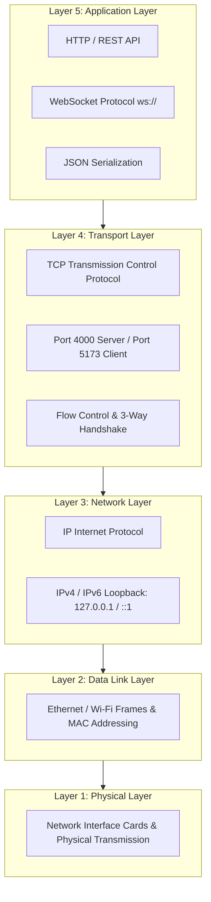

# Comprehensive Academic Integration Guide: CN + FLAT + FSWD

> **Project Title**: Online Food Ordering and Delivery Tracking System Using DFA  
> **Course Subjects**:
> 1. Computer Networks (CN)
> 2. Formal Languages and Automata Theory (FLAT)
> 3. Full Stack Web Development (FSWD)

This document provides an in-depth theoretical and technical analysis of how Computer Networks, Automata Theory, and Full Stack Web Development are interwoven within this application.

---

## 1. The Tripartite Integration Concept

In modern software engineering, web applications are often designed as loosely organized CRUD interfaces without formal mathematical validation. This project introduces a paradigm where **automata theory provides the mathematical truth**, **networking provides the communication substrate**, and **full stack web development provides the human interface and data persistence**.

### Conceptual Relationship Matrix

| Concern | Formal Languages & Automata Theory (FLAT) | Computer Networks (CN) | Full Stack Web Development (FSWD) |
| :--- | :--- | :--- | :--- |
| **State Management** | DFA State Set $Q = \{S_0, \dots, S_6\}$ | State transmitted via JSON payload | Mongoose `currentState` field and React UI state |
| **Actions / Events** | Input Alphabet $\Sigma = \{\text{confirm}, \dots\}$ | HTTP Request Methods (`PATCH`, `POST`) | Button click handlers and form submissions |
| **Validation** | Transition Function $\delta(q, \sigma) \to Q$ | HTTP Status Codes (`200 OK`, `422 Unprocessable`) | Express middleware and React error toast banners |
| **Terminal States** | Accepting States $F = \{S_5, S_6\}$ ($\delta(F, \Sigma) = \emptyset$) | Socket room closure & final payload push | Read-only order receipts, disabled action controls |
| **Data Invariants** | Path containment in language $L(M)$ | Guaranteed packet delivery over TCP stream | MongoDB transaction safety and history audit logs |

---

## 2. Anatomy of a Single Request: The Complete Journey Across All 3 Subjects

Consider a concrete real-world action:  
**The restaurant chef clicks the "Mark Food Ready" button on the Admin Dashboard.**

Here is the exact step-by-step trace showing where CN, FLAT, and FSWD intersect:

```text
[Step 1: FSWD - React UI]
   Chef clicks "Mark Food Ready" on the React Admin Dashboard.
   React triggers an asynchronous fetch() call:
   Endpoint: PATCH /api/orders/6afd9ec611456431927c4cf2/transition
   Headers: Authorization: Bearer <JWT_Token>, Content-Type: application/json
   Payload: { "action": "food_ready" }

[Step 2: CN - Application & Presentation Layer]
   The browser serializes the JavaScript object into a UTF-8 JSON byte stream.
   The HTTP/1.1 request header is constructed:
   PATCH /api/orders/... HTTP/1.1
   Host: localhost:4000
   Content-Length: 24

[Step 3: CN - Transport Layer (TCP Port 4000)]
   The JSON string is segmented into TCP packets.
   The operating system checks the existing TCP socket connection on port 4000.
   Packet flags, sequence numbers, and checksums are computed.
   Packets are routed via loopback IP (127.0.0.1) to the Node.js server.

[Step 4: FSWD - Express Middleware & Authentication]
   Node.js receives the byte stream on its TCP socket.
   Express parses the HTTP method and path.
   The `authenticate` middleware verifies the HMAC-SHA256 signature on the JWT.
   The `requireAdmin` middleware checks if `req.user.role === 'admin'`.
   The order is retrieved from MongoDB: order.currentState is found to be "S2".

[Step 5: FLAT - DFA Mathematical Validation]
   The server calls: transition("S2", "food_ready") in orderDfa.js.
   The DFA engine consults the formal transition function:
      delta(S2, food_ready) -> S3 (Food Prepared)
   Result: { valid: true, nextState: "S3", label: "Food Prepared" }.

[Step 6: FSWD - Persistence Tier (MongoDB)]
   order.currentState is updated to "S3".
   An audit record is appended to order.orderHistory:
      { state: "S3", action: "food_ready", timestamp: Date.now(), actor: "Chef Admin" }
   order.save() is executed, committing the update to MongoDB.

[Step 7: CN - Real-Time Push (WebSocket / Socket.io)]
   The server broadcasts an event over the persistent TCP WebSocket stream:
   Event: "order:state_changed"
   Room: "order:6afd9ec611456431927c4cf2"
   Payload: { currentState: "S3", label: "Food Prepared" }
   The customer's browser receives the frame and updates the timeline UI immediately.

[Step 8: CN & FSWD - HTTP Response Cycle]
   The server sends an HTTP 200 OK response with the updated order JSON.
   The React Admin UI receives the response and changes the button to "Dispatch Order".
```

---

## 3. Computer Networks (CN) Deep Dive

### 1. The 5-Layer Internet Protocol Stack in This Application



### 2. TCP 3-Way Handshake Mechanics
Every HTTP request and WebSocket upgrade begins with TCP connection setup:
1. **$C \to S$ (`SYN`, $seq = 1000$)**: Client initiates connection to server port 4000.
2. **$S \to C$ (`SYN-ACK`, $seq = 5000$, $ack = 1001$)**: Server acknowledges client's sequence number and sends its own.
3. **$C \to S$ (`ACK`, $seq = 1001$, $ack = 5001$)**: Client confirms. The TCP socket is now in `ESTABLISHED` state.

### 3. Comparison: HTTP Polling vs. WebSockets

| Metric | Periodic HTTP Polling (Fallback) | WebSockets via Socket.io (Active) |
| :--- | :--- | :--- |
| **Connection Model** | New TCP connection or keep-alive per request | Single persistent full-duplex TCP socket |
| **Initiation** | Client-initiated (`GET /api/orders/:id`) | Server-initiated push (`order:state_changed`) |
| **Overhead** | High (HTTP headers sent every 5 seconds) | Low (tiny 2-byte WebSocket frame header) |
| **Latency** | Average 2.5s delay (bounded by 5s interval) | Instantaneous (< 5ms over localhost) |
| **Server Load** | 12 HTTP requests/minute per active user | Zero requests until state actually changes |

---

## 4. Formal Languages & Automata Theory (FLAT) Deep Dive

### 1. Mathematical Formalism

$$M = (Q, \Sigma, \delta, q_0, F)$$

Where:
- $Q = \{S_0, S_1, S_2, S_3, S_4, S_5, S_6\}$ (finite state set)
- $\Sigma = \{\text{confirm}, \text{start\_preparation}, \text{food\_ready}, \text{dispatch}, \text{deliver}, \text{cancel}\}$ (input alphabet)
- $q_0 = S_0$ (initial state)
- $F = \{S_5, S_6\}$ (final / accepting states)
- $\delta: Q \times \Sigma \to Q$ is the transition table.

### 2. Proof of Determinism
A finite automaton is **deterministic** if and only if:
1. For every state $q \in Q$ and input symbol $\sigma \in \Sigma$, there is **at most one** next state $p \in Q$ such that $\delta(q, \sigma) = p$.
2. There are **no $\epsilon$-transitions** (spontaneous state changes without consuming an input symbol).

**Proof for this system**:
- Inspecting $\delta(S_0, \text{confirm}) = S_1$. There is exactly one output state.
- Inspecting $\delta(S_0, \text{cancel}) = S_6$. Exactly one output state.
- For all $(q, \sigma)$, $|\delta(q, \sigma)| \le 1$.
- No transition occurs without an authenticated API request carrying an explicit input symbol $\sigma \in \Sigma$.
- Therefore, $M$ is strictly a **Deterministic Finite Automaton**.

### 3. Terminal State Invariant Proof
- Let $F = \{S_5, S_6\}$.
- For any $f \in F$ and any $\sigma \in \Sigma$:
  $$\delta(f, \sigma) = \emptyset$$
- In the code:
  ```javascript
  if (isFinalState(currentState)) {
    return { valid: false, error: `Cannot transition from final state "${currentState}"` };
  }
  ```
- **Invariant**: Once an order enters $S_5$ or $S_6$, it remains in that state permanently. This mathematically satisfies the definition of terminal sink states.

---

## 5. Full Stack Web Development (FSWD) Deep Dive

### 1. Security & Cryptographic Best Practices
- **Password Salting and Hashing**: Passwords are never stored in plaintext. `bcryptjs` creates a unique salt per user with 10 calculation rounds, mitigating rainbow table attacks.
- **Stateless Bearer Tokens**: JWTs signed with `process.env.JWT_SECRET` eliminate the need for server-side session stores while maintaining cryptographic authenticity.
- **Server-Side Price Authority**: When an order is placed (`POST /api/orders`), the client only sends `{ foodId, quantity }`. The server independently looks up the authoritative price from the MongoDB `FoodItem` document, preventing client-side price tampering.

### 2. Dual-Mode Database Architecture (In-Memory + Atlas)
A hallmark of senior architecture in this project is its database connector (`server/src/db.js`):
1. **Primary Attempt**: Tries to connect to `process.env.MONGODB_URI` with a 2500ms timeout.
2. **Graceful Fallback**: If no local or remote MongoDB server responds, it automatically instantiates `mongodb-memory-server`.
3. **Auto-Seed**: On first start, it automatically seeds default admin/customer accounts and 12 menu items.
4. **Benefit**: Evaluators, professors, and students can clone and run the application without installing or configuring any database software.

---

## 6. Viva Checklist for Students

When presenting this project to examiners, highlight the following talking points:

1. **Point to the DFA Code**: Open `server/src/dfa/orderDfa.js` and show the formal mathematical definitions of $Q, \Sigma, \delta, q_0, F$.
2. **Demonstrate State Rejection**: Open the Terminal and run `npm test` to prove that all 7 automated unit tests pass.
3. **Show Live Rejection**: Show how the Admin panel or API returns HTTP `422 Unprocessable Entity` when an invalid transition (like `S0 -> dispatch`) is attempted.
4. **Open the Network Inspector**: Navigate to `http://localhost:5173/network` and point to the live server metrics, TCP socket counter, and OSI layer breakdown.
5. **Show Real-Time WebSockets**: Open two browser windows side-by-side (Customer on the left, Admin on the right). Click "Start Cooking" in Admin and show the customer's timeline update instantly without refreshing!
